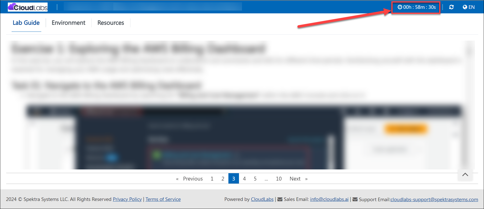
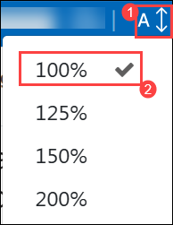
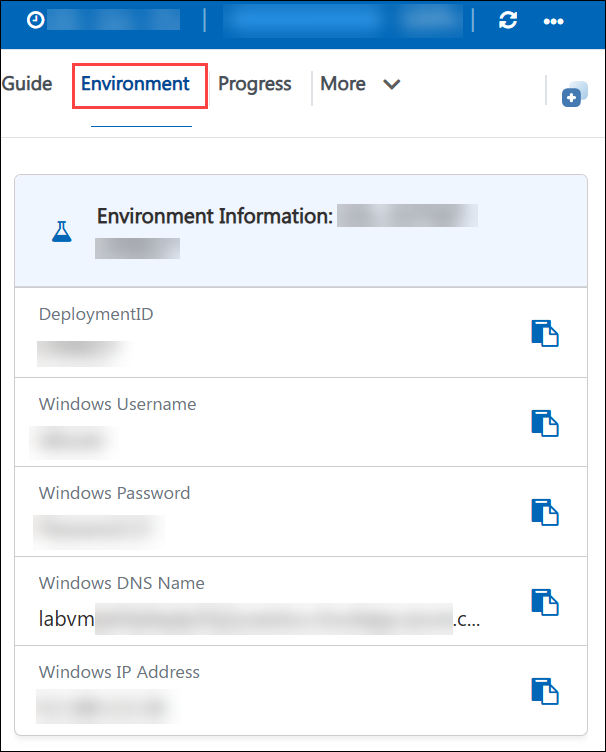
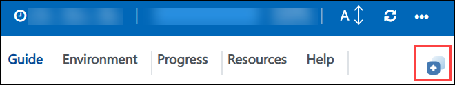
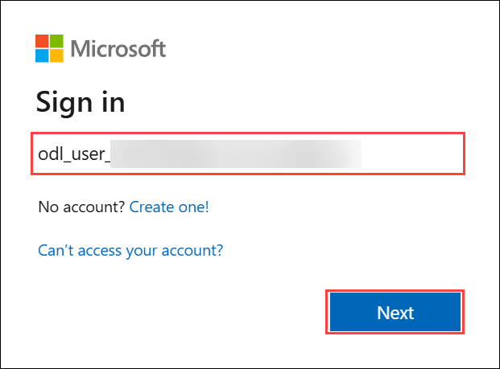
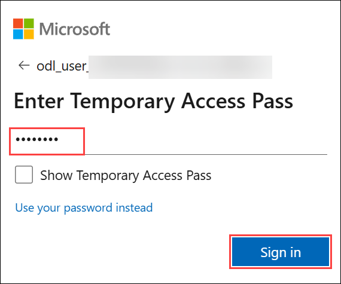
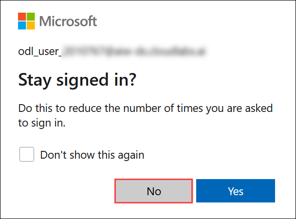
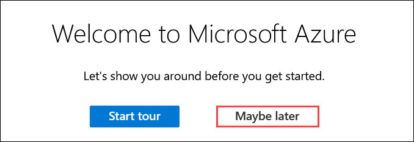
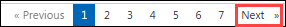

# Getting Started with Micro-Segmentation using Palo Alto Networks VM-Series on Azure

### Overall Estimated Duration: 120 Minutes

## 📘 Lab Scenario

Your organization runs banking workloads on Azure, with the accounts, transactions, and payments services on separate Ubuntu VMs. Some of these VMs share a subnet, so traditional network security groups and subnet-level controls cannot stop traffic between them. The security team wants to inspect and control east-west traffic between individual workloads, even inside the same subnet, without redesigning the network.

In this lab, you use a Palo Alto Networks VM-Series firewall managed from Strata Cloud Manager to apply micro-segmentation to these workloads.

## 📖 Lab Overview

In this hands-on lab, you use Azure Cloud Shell and Terraform to deploy two virtual networks, a Palo Alto Networks VM-Series firewall, and three Ubuntu VMs. VM1 runs the panredirect agent, which sends its traffic to the firewall through a Geneve tunnel. You then onboard the firewall in Strata Cloud Manager, push the security policies, and test that traffic from VM1 to VM2 is blocked even though they are in the same subnet, while traffic from VM1 to VM3 is allowed.

## 🎯 Objectives

- **Exercise 1 - Run Terraform:** Use Azure Cloud Shell to run the Terraform deployment that provisions the virtual networks, the VM-Series firewall, and the three Ubuntu VMs.

## ⚙️ Prerequisites

Participants should have:

- Basic understanding of Azure networking, including virtual networks, subnets, and virtual machines.
- Familiarity with running commands in a Bash shell.
- Basic knowledge of Terraform (`init`, `apply`, `output`).
- Basic understanding of firewall security policies.

## 🏗️ Architecture

The lab deploys two virtual networks in the **East US** region. The workload network contains three Ubuntu VMs: VM1 and VM2 share one subnet, and VM3 is in a second subnet. The security network contains the Palo Alto Networks VM-Series firewall, which is licensed with your auth code and bootstrapped at first boot from an Azure file share. VM1 runs the panredirect agent, which sends its traffic to the firewall through a Geneve tunnel, so the firewall can inspect it even when the destination is in the same subnet. The firewall is managed from Strata Cloud Manager, where you define and push the security policies.

### 🔍 Explanation of Components

- **Azure Cloud Shell:** The browser-based shell where you run Azure CLI and Terraform to deploy the lab.
- **Terraform:** Deploys and configures all the Azure resources for the lab.
- **Palo Alto Networks VM-Series firewall:** Inspects VM1's traffic and enforces the security policies.
- **Storage account (bootstrap):** Holds the bootstrap files that license and configure the firewall at first boot.
- **VM1, VM2, and VM3 (Ubuntu):** The banking accounts, transactions, and payments workloads used to test the policies.
- **panredirect agent:** Runs on VM1 and redirects its traffic to the firewall through a Geneve tunnel.
- **Strata Cloud Manager:** The Palo Alto Networks cloud console used to onboard the firewall, push policies, and review logs.

## 🚀 Getting Started with the Lab

Welcome to the Micro-Segmentation using Palo Alto Networks VM-Series on Azure lab. Begin by setting up the lab environment.

> **Note:** The lab duration is shown at the top right corner of your lab environment page once the lab is launched by clicking the **Launch Lab** button. The timer starts automatically, so keep an eye on it while performing your lab tasks.

   

## Lab Guide Zoom In/Zoom Out

To adjust the zoom level for the environment page, click the **A↕** icon located next to the timer in the lab environment.



## Exploring Your Lab Resources

To view your lab credentials and the values used in this lab, such as the **Auth Code**, navigate to the **Environment** tab.



## Utilizing the Split Window Feature

For convenience, you can open the lab guide in a separate window by selecting the **Split Window** button from the top right corner.



## ☁️ Get Started with Azure Portal

1. Open a new browser tab and navigate to the Azure portal:

   ```
   https://portal.azure.com
   ```

1. On the **Sign in to Microsoft Azure** page, enter the following username and click **Next**.

   - **Email/Username:** <inject key="AzureAdUserEmail"></inject>

      

1. Enter the following password and click **Sign in**.

   - **Password:** <inject key="AzureAdUserPassword"></inject>

      

   > **Note:** You can also find these values on the **Environment** tab.

1. If you see the **Stay signed in?** prompt, click **No**.

   

1. If you see the **Welcome to Microsoft Azure** pop-up, click **Cancel** to skip the tour.

   

1. If you see the pop-up **You have free Azure Advisor recommendations!**, close the window to continue the lab.

> **Note:** You must deploy the resources in the following region: **East US (eastus)**

## 🆘 Support Contact

The CloudLabs support team is available 24/7, 365 days a year, via email and live chat to ensure seamless assistance at any time. We offer dedicated support channels tailored specifically for both learners and instructors, ensuring that all your needs are promptly and efficiently addressed.

Learner Support Contacts:

- Email Support: [cloudlabs-support@spektrasystems.com](mailto:cloudlabs-support@spektrasystems.com)
- Live Chat Support: https://cloudlabs.ai/labs-support

Click **Next** from the bottom right corner to embark on your Lab journey!



Now you're all set to explore micro-segmentation on Azure. Feel free to reach out if you have any questions along the way. Enjoy your lab!

### Happy Learning!!
