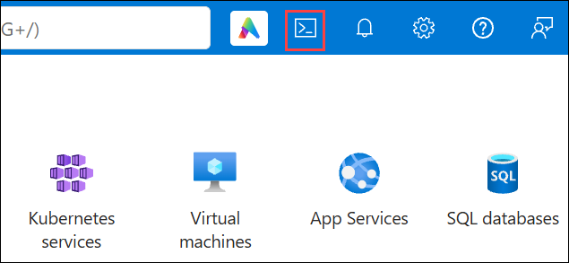
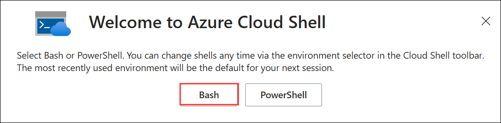
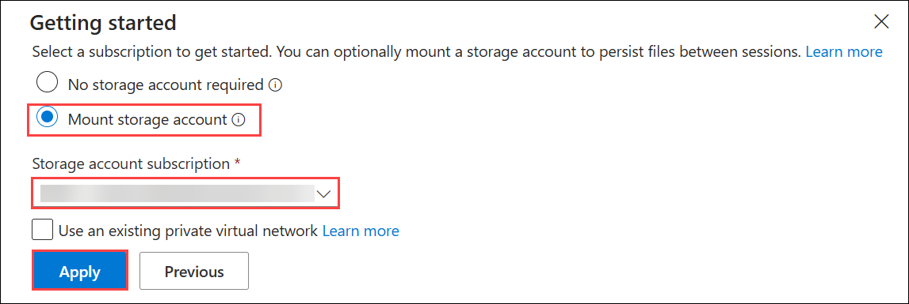

# Exercise 1: Run Terraform

### Estimated Duration: 45 Minutes

## Overview

In this exercise, you use Azure Cloud Shell to run the Terraform deployment for the micro-segmentation lab. The package builds two virtual networks, a Palo Alto Networks VM-Series firewall, and three Ubuntu VMs. VM1 runs the panredirect agent, which sends its traffic to the firewall through a Geneve tunnel. The firewall is licensed with your auth code and registers with Strata Cloud Manager at first boot.

## Objectives

You will be able to complete the following tasks:

- Task 1: Open Azure Cloud Shell
- Task 2: Download the lab package
- Task 3: Configure the Terraform variables
- Task 4: Deploy the lab

## Task 1: Open Azure Cloud Shell

1. In the Azure portal, click the **Cloud Shell** icon in the top navigation bar.

   

1. When prompted, select **Bash**.

   

1. If you are asked to set up storage, select **Mount storage account**, choose your subscription, and click **Apply**. On the next screen, select **We will create a storage account for you** and click **Next**.

   

   > **Note:** Storage keeps your lab files and Terraform state if Cloud Shell restarts.

1. Run the following command to confirm your subscription:

   ```bash
   az account show --output table
   ```

1. Run the following command to make Terraform use the same subscription:

   ```bash
   export ARM_SUBSCRIPTION_ID=$(az account show --query id -o tsv)
   ```

   > **Note:** This lasts only for the current session, so run it again if Cloud Shell restarts.

## Task 2: Download the lab package

1. Run the following command to download the package:

   ```bash
   curl -L -o ~/clouddrive/microseg-lab-terraform.zip "https://experienceazure.blob.core.windows.net/templates/panw/microseg-lab-terraform.zip"
   ```

1. Run the following command to extract it:

   ```bash
   unzip -q ~/clouddrive/microseg-lab-terraform.zip -d ~/clouddrive
   ```

1. Run the following command to make the lab files writable:

   ```bash
   chmod -R u+w ~/clouddrive/microseg-lab
   ```

1. Run the following command to move into the Terraform folder:

   ```bash
   cd ~/clouddrive/microseg-lab/terraform
   ```

## Task 3: Configure the Terraform variables

1. Run the following command to accept the Palo Alto Networks VM-Series Marketplace terms:

   ```bash
   az vm image terms accept --publisher paloaltonetworks --offer vmseries-flex --plan byol
   ```

1. In the lab environment, select the **Environment** tab and note the **Auth Code**. You use this value in the next steps.

   - **Auth Code:** <inject key="AuthCode"></inject>


   > **Note:** The auth code is unique to your lab environment. Use the value shown in your **Environment** tab and not the example value in the settings file.

1. Run the following command to create your settings file:

   ```bash
   cp terraform.tfvars.example terraform.tfvars
   ```

1. Run the following command to open the settings file in the editor:

   ```bash
   code terraform.tfvars
   ```

1. Replace the placeholder values with the following values:

   - **fw_auth_code:** <inject key="AuthCode"></inject>

   The updated lines look like this, with your own auth code:

   ```
   fw_auth_code      = "<your-auth-code>"
   fw_pin_id         = "ca9ca928-2dfd-4d9a-ba9d-92f63b9f0254"
   fw_pin_value      = "8b41cb1c9f9f49e982f542567d5f3d43"
   ```

   > **Note:** Keep the double quotes around each value. Leave the usernames and passwords as they are (**labadmin** / **Paloalto1!**).

1. Press **Ctrl+S** to save the file, then press **Ctrl+Q** to close the editor.

## Task 4: Deploy the lab

1. Run the following command to download the Terraform providers:

   ```bash
   terraform init
   ```

1. Run the following command to deploy the package:

   ```bash
   terraform apply -auto-approve
   ```

   This creates the networks, storage account, firewall, and three VMs, then waits for the firewall to bootstrap and the Geneve tunnel on VM1 to come up (about 25 minutes). Wait until it finishes with **Apply complete!**

   > **Note:** Click inside the terminal every few minutes so Cloud Shell stays active.

1. Run the following command to view the deployment details:

   ```bash
   terraform output
   ```

1. Note the **fw_mgmt_public_ip** and the **vm1** value under **vm_mgmt_public_ips**.

1. If Cloud Shell closes or restarts during deployment, complete the following steps. Otherwise, continue to the next exercise.

   - Reopen **Bash** in Cloud Shell and run the following command to return to the Terraform folder:

     ```bash
     cd ~/clouddrive/microseg-lab/terraform
     ```

   - Run the following command to set the subscription again:

     ```bash
     export ARM_SUBSCRIPTION_ID=$(az account show --query id -o tsv)
     ```

   - Run the following command to allow your new Cloud Shell address on the storage account:

     ```bash
     terraform apply -target=azurerm_storage_account.bootstrap -auto-approve
     ```

     > **Note:** Wait 1–2 minutes after this command finishes before continuing.

   - Run the following command to resume the deployment:

     ```bash
     terraform apply -auto-approve
     ```

     It continues from where it stopped and does not create duplicates.

## Summary

In this exercise, you configured the Terraform variables with your auth code and device certificate PIN, and deployed the virtual networks, the VM-Series firewall, and the three Ubuntu VMs on Azure.

### You have successfully completed this exercise. Click **Next** to continue to the next exercise.
